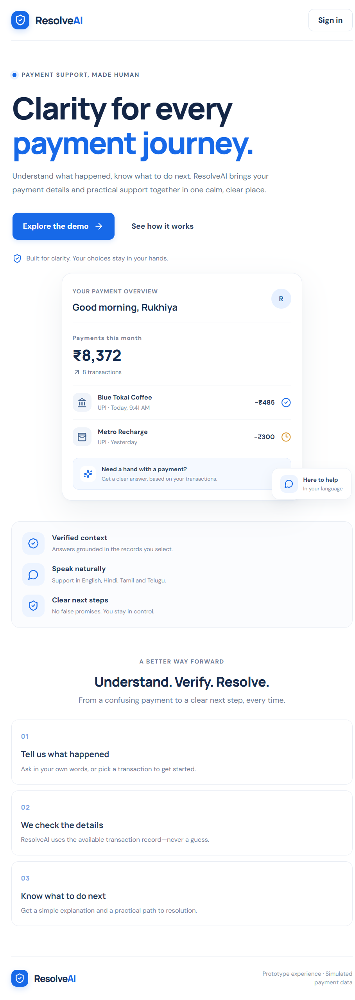
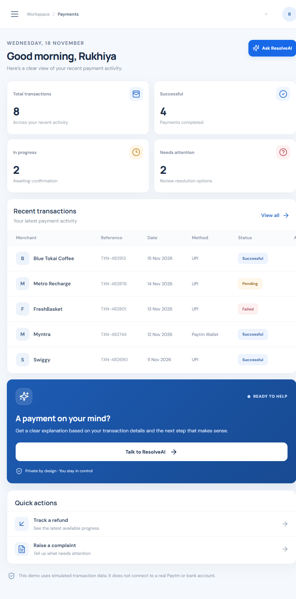
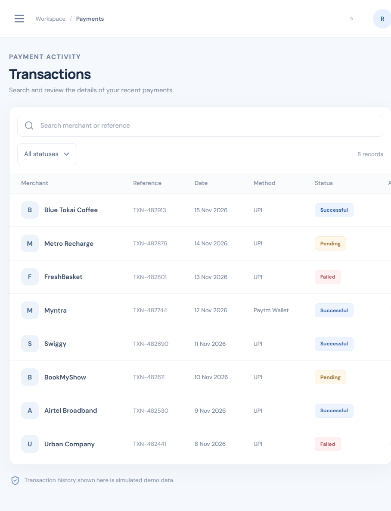
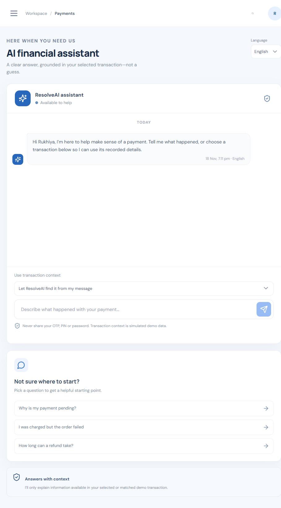

# Paytm ResolveAI

ResolveAI is a responsive prototype for understanding and resolving payment questions. The demo uses simulated transaction data stored in SQLite; it does not connect to a real Paytm or bank account.

## Run locally

Requirements: Node.js 18+ and Python 3.10+.

1. Install frontend packages:
   ```powershell
   npm install
   ```
2. Install backend packages:
   ```powershell
   python -m pip install -r requirements.txt
   ```
3. Start the API in a terminal:
   ```powershell
   python -m uvicorn backend.main:app --reload --port 8001
   ```
4. Start the web app in another terminal:
   ```powershell
   npm run dev
   ```
5. Open `http://localhost:5173`. The frontend API target defaults to `http://127.0.0.1:8001/api`.

The API creates `resolveai.db` and seeds simulated customer, transaction, refund, and support records the first time it starts.

## Screenshots

### Homepage



### Dashboard



### Transactions



### AI assistant



## Optional Sarvam AI

Copy `.env.example` to `.env` and set `SARVAM_API_KEY` on the backend host. The key is read only by FastAPI and is never sent to the browser. `SARVAM_MODEL` defaults to Sarvam's supported `sarvam-105b-conversations` chat model. `VITE_API_BASE_URL` sets the frontend API URL and defaults to `http://127.0.0.1:8001/api`. Restart FastAPI and Vite after changing environment configuration.

Without a key, the assistant uses a local intent guide and returns English-only demo guidance. The UI explicitly says this is not an AI-generated answer or translation; native-language questions can be classified locally, but a translated answer needs Sarvam. If Sarvam is configured but unreachable or returns an invalid response, the same clearly labeled fallback is used.

With a key, the backend sends the conversation history, selected response language, and only the matched simulated transaction context to Sarvam’s chat-completions API. It uses `https://api.sarvam.ai/v1/chat/completions`, authenticates with `api-subscription-key`, and defaults to the documented `sarvam-105b-conversations` model with JSON response mode. It asks Sarvam to classify intent before answering, request clarification when needed, and avoid unsupported claims or authentication secrets. Conversation messages and the selected language persist in the browser; each saved message retains its original language.

On startup, the backend logs its `.env` path and only whether `SARVAM_API_KEY` is present (never the key). A failed Sarvam request logs only its exception type and HTTP status; the assistant surfaces that safe diagnostic alongside its English demo fallback.

## API

- `GET /api/health`
- `GET /api/transactions?status=&search=`
- `GET /api/transactions/{transaction_id}`
- `POST /api/assistant/chat`
- `GET /api/refunds` and `GET /api/refunds/{transaction_or_refund_id}`
- `POST /api/complaints`, `GET /api/complaints`, and `GET /api/complaints/{complaint_id}`
- `PATCH /api/complaints/{complaint_id}/status`

The assistant supports `en-IN`, `hi-IN`, `ta-IN`, and `te-IN`. Multilingual generation is available when Sarvam is configured; the no-key response explicitly notes its English-only limitation.

Complaints progress through `received` → `details_being_checked` → `action_required` / `resolution_update` → `resolved`. The API validates transitions and stores timestamped status history. Status updates are for the demo workflow only and do not imply that a real support team is investigating a case.

## Tests

Install the test dependencies and run the backend suite:
```powershell
python -m pip install -r requirements-dev.txt
python -m pytest backend\tests -q
```

## Safety and prototype scope

- All sample payments, refunds, and customer details are fictional.
- No payment is initiated, reversed, or otherwise changed by this app.
- Refund dates and statuses are illustrative records, not bank guarantees.
- Never enter an OTP, UPI PIN, password, or full bank/card number.
- Configure `FRONTEND_ORIGINS` (comma-separated) and `DATABASE_PATH` in the backend environment when deploying outside local development.
